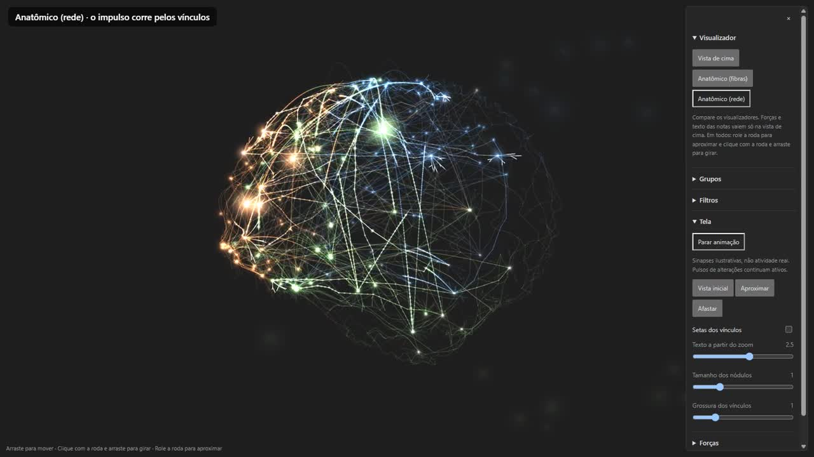
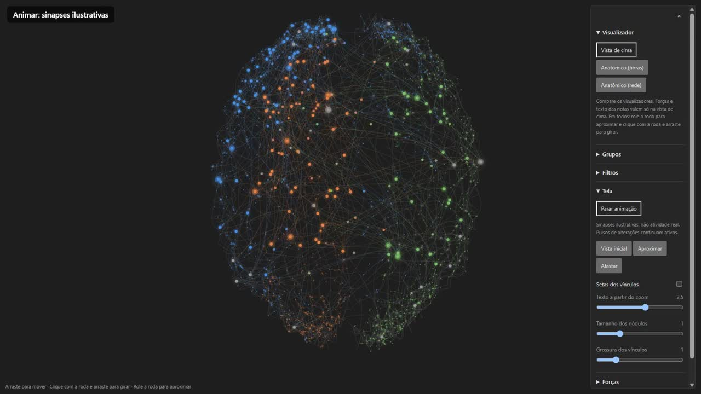
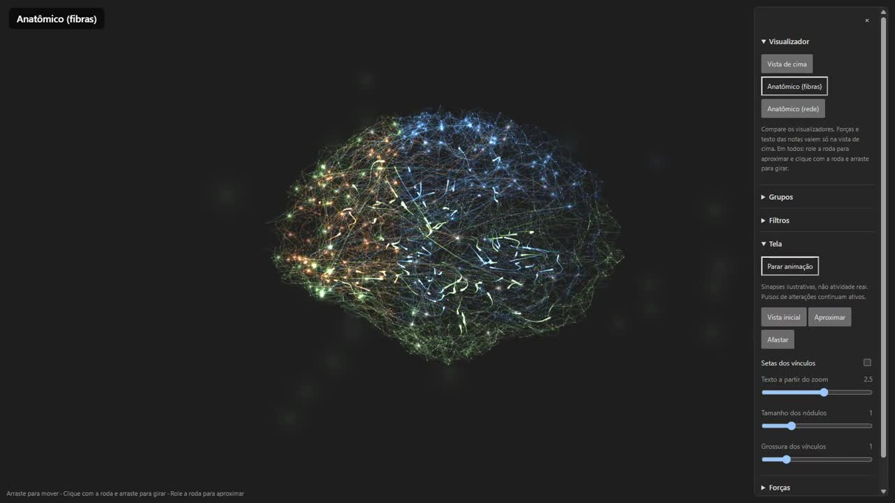

# Reweave

**Português** · [English](#english)

Plugin do Obsidian que transforma suas notas e os vínculos entre elas em um **cérebro 3D vivo**: cada nota é um ponto, cada vínculo é um fio, e o gráfico de cores do Obsidian vira as regiões do cérebro. Nada do seu vault é alterado e nada sai do seu computador.

## Vídeos (60 fps)

Gravados a partir do plugin com notas **fictícias**, a 60 quadros por segundo. **[Assistir na página dos vídeos](https://joaoppk2.github.io/reweave/)** (clique nas imagens). Os arquivos `.mp4` também estão em `docs/videos` para baixar.

| | |
| :--- | :--- |
| [](https://joaoppk2.github.io/reweave/) | **[Visão geral (47 s)](https://joaoppk2.github.io/reweave/)**: os três visualizadores e todas as funções: animação, notas pulsando, zoom, rotação, inclinação, busca e grupos. |
| [](https://joaoppk2.github.io/reweave/#vista-de-cima) | **[Vista de cima (14 s)](https://joaoppk2.github.io/reweave/#vista-de-cima)** |
| [](https://joaoppk2.github.io/reweave/#anatomico-fibras) | **[Anatômico (fibras) (12 s)](https://joaoppk2.github.io/reweave/#anatomico-fibras)** |
| [](https://joaoppk2.github.io/reweave/#anatomico-rede) | **[Anatômico (rede) (13 s)](https://joaoppk2.github.io/reweave/#anatomico-rede)** |

## Visualizadores

Escolha em **Visualizador**, no painel da direita. Os três usam as mesmas notas, vínculos e cores; dá para trocar a qualquer momento e comparar.

- **Vista de cima**: o cérebro visto de cima, em Canvas 2D, com texto das notas, setas dos vínculos e as forças do gráfico do Obsidian.
- **Anatômico (fibras)**: o cérebro de lado, em WebGL, com feixes de fibras e sinapses ilustrativas sobre as suas notas.
- **Anatômico (rede)**: o cérebro de lado como um casulo escuro, em WebGL. As fibras só acendem quando o impulso passa: ele corre **pelos vínculos reais** entre as suas notas, atravessa de um hemisfério para o outro e acende o corpo da célula e os dendritos. Com menos de 6 vínculos usa uma rede de fundo, ilustrativa.

## O que ele faz

- **Regiões = grupos de cor do gráfico do Obsidian** (`graph.json`). Cada grupo vira uma região; nomes e descrições ficam nas configurações do plugin, sem mexer na regra do gráfico. Dá para criar grupos de cor próprios no painel, com a mesma sintaxe de busca.
- **Filtros**: busca (ignora acentos), etiquetas, anexos, notas órfãs, modificadas hoje ou esta semana, e foco em uma região.
- **Animar**: sinapses ilustrativas (não são atividade real). Notas **modificadas** pulsam por 4 segundos.
- **Tela**: tamanho dos nódulos, grossura dos vínculos, setas, zoom e **Vista inicial**.
- **Forças** (vista de cima): central, repulsão, vínculos e distância; um botão copia os valores do seu gráfico do Obsidian.
- **Clique** abre a nota; o **hover** mostra a prévia do Obsidian.
- O visualizador escolhido fica salvo.

### Controles

| | Vista de cima | Anatômico (fibras / rede) |
| :--- | :--- | :--- |
| Arrastar | mover | mover |
| Shift + arrastar | girar | girar |
| Roda do mouse | aproximar | **girar** |
| Ctrl + roda (ou pinça do touchpad) | | aproximar |
| Shift + roda | | inclinar |

## Instalação

**Pelo GitHub (manual)**

1. Baixe `main.js`, `manifest.json` e `styles.css` em [Releases](../../releases/latest).
2. Copie os três para `<seu vault>/.obsidian/plugins/reweave/`.
3. No Obsidian, vá em *Configurações → Plugins da comunidade*, ative **Reweave** e use o ícone do cérebro ou o comando **Reweave: Abrir cérebro**.

**Com o BRAT**: adicione `joaoppk2/reweave` como plugin beta.

Requisitos: Obsidian 1.8 ou mais novo, no computador. Os visualizadores 3D precisam de WebGL; sem ele o plugin volta sozinho para a vista de cima. Para testar sem arriscar suas notas, instale primeiro num vault de teste.

## Privacidade

O plugin só **lê**: a lista de arquivos, os vínculos e as etiquetas que o Obsidian já indexou, e o `graph.json`. Não altera notas, não faz chamadas de rede e não tem telemetria. Só grava as próprias configurações (`data.json` do plugin).

## Limites conhecidos

- A interface está em português.
- Nos visualizadores 3D não há texto das notas na tela (o hover mostra a prévia); forças e setas valem só na vista de cima.
- Os visualizadores 3D usam brilho aditivo e mantêm o fundo escuro mesmo em temas claros.
- Não foi testado no celular nem em vaults muito grandes.

## Desenvolvimento

Node.js 22+ e npm.

```sh
npm ci
npm run typecheck
npm test                          # compila e roda os testes
npm run build                     # gera main.js
npm run build && npm run preview  # prévia no navegador: http://127.0.0.1:5187/ui
```

A prévia usa notas fictícias e não lê nenhum vault. Para gravar vídeos quadro a quadro, abra `/ui?virtual=1` e avance o tempo com `window.__step(ms)`.

Estrutura: `src/brain-canvas.ts` (vista de cima, Canvas 2D), `src/brain-gl.ts` (visualizadores 3D) sobre `src/gl-engine.ts` (motor WebGL), `src/sidebar.ts` (painel), `src/vault-source.ts` (leitura do vault).

## Licença

[MIT](LICENSE)

---

<a id="english"></a>

# Reweave (English)

An Obsidian plugin that turns your notes and the links between them into a **living 3D brain**: every note is a point, every link is a wire, and your Obsidian graph color groups become the brain's regions. Your vault is never modified and nothing leaves your computer.

## Videos (60 fps)

Recorded from the plugin with **fictional** notes at 60 frames per second. **[Watch them on the videos page](https://joaoppk2.github.io/reweave/)**: overview (47 s), top view, anatomical (fibers) and anatomical (network). The `.mp4` files are also in `docs/videos` for download.

## Visualizers

Pick one under **Visualizador** (side panel). All three use the same notes, links and colors, so you can switch and compare.

- **Vista de cima** (top view): the brain seen from above, drawn on a 2D canvas, with note labels, link arrows and the Obsidian graph forces.
- **Anatômico (fibras)** (anatomical, fibers): a side view in WebGL, with fiber bundles and illustrative synapses over your notes.
- **Anatômico (rede)** (anatomical, network): a dark side-view cocoon in WebGL. Fibers light up only while an impulse passes: it travels **along your real note links**, crosses between hemispheres and lights up the cell body and its dendrites. With fewer than 6 links it falls back to an illustrative background network.

## Features

- **Regions = Obsidian graph color groups** (`graph.json`), with names and descriptions in the plugin settings. You can also define extra color groups in the panel using the same query syntax.
- **Filters**: accent-insensitive search, tags, attachments, orphans, modified today / this week, and region focus.
- **Animate**: illustrative synapses (not real activity). **Modified** notes pulse for 4 seconds.
- **Display**: node size, link width, arrows, zoom and **Vista inicial** (reset view).
- **Forces** (top view): center, repel, link and distance, with a button that copies your Obsidian graph values.
- **Click** opens the note; **hover** shows Obsidian's page preview. Your chosen visualizer is remembered.

Controls in the 3D visualizers: drag moves, Shift+drag rotates, **mouse wheel rotates**, Ctrl+wheel (or trackpad pinch) zooms, Shift+wheel tilts.

## Install

1. Download `main.js`, `manifest.json` and `styles.css` from the [latest release](../../releases/latest).
2. Copy them to `<your vault>/.obsidian/plugins/reweave/`.
3. Enable **Reweave** under *Settings → Community plugins*, then use the brain ribbon icon or the command **Reweave: Abrir cérebro**.

Or add `joaoppk2/reweave` in **BRAT**. Requires Obsidian 1.8+ on desktop; the 3D visualizers need WebGL (without it the plugin falls back to the top view). Try it in a test vault first.

## Privacy

The plugin is **read-only**: it reads the file list, links and tags Obsidian already indexed, plus `graph.json`. It does not edit notes, make network requests or collect telemetry. It only writes its own settings.

## Known limits

The interface is in Portuguese. The 3D visualizers have no on-screen note labels (hover shows the preview), forces and arrows only apply to the top view, the 3D canvas stays dark in light themes, and mobile and very large vaults are untested.

## Development

```sh
npm ci && npm run typecheck && npm test
npm run build && npm run preview   # http://127.0.0.1:5187/ui, fictional notes
```

## License

[MIT](LICENSE)
